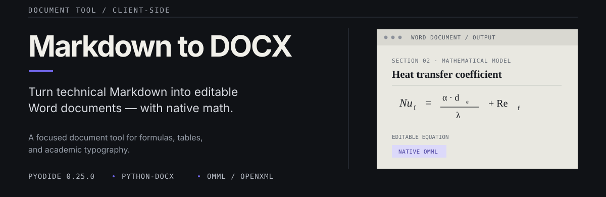
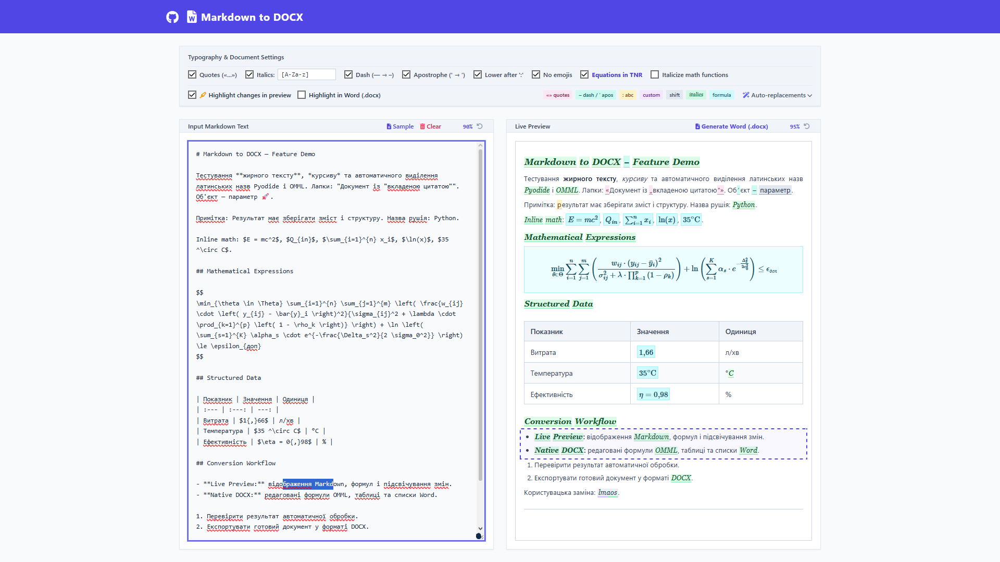
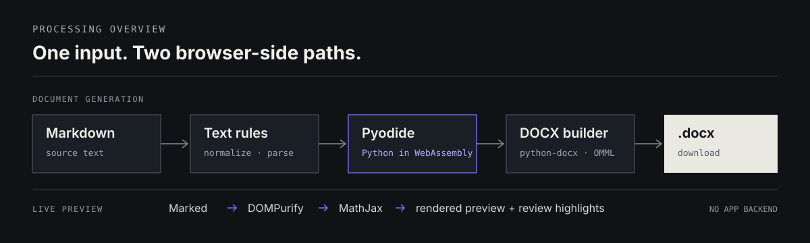

<p align="center">
  
</p>

<p align="center">
  <strong>Markdown to editable DOCX</strong> &nbsp;·&nbsp;
  <strong>Native Word equations</strong> &nbsp;·&nbsp;
  <strong>Browser-side processing</strong>
</p>

<p align="center">
  <a href="#overview">Overview</a> ·
  <a href="#features">Features</a> ·
  <a href="#supported-input">Supported input</a> ·
  <a href="#architecture">Architecture</a> ·
  <a href="#getting-started">Getting started</a> ·
  <a href="#configuration">Configuration</a>
</p>

## Overview

**Markdown to DOCX** converts technical and academic Markdown into Microsoft Word (`.docx`) documents. Its main focus is mathematical notation: supported LaTeX expressions are translated into native **Office Math Markup Language (OMML)** structures, so equations remain editable Word math objects instead of being embedded as images.

The application combines a Markdown editor, a rendered preview, configurable typography rules, and a Python document-generation engine running in the browser through **Pyodide** and WebAssembly. No application backend is used to process or store the document content.

## The interface

<p align="center">
  
</p>

## Features

### Native Word mathematics

- convert inline `$...$` and display `$$...$$` expressions into Word-native OMML math elements;
- build structured fractions, including nested fractions, subscripts, superscripts, and combined subscript/superscript expressions;
- handle overbars (`\bar{}`), vector accents (`\vec{}`), Greek symbols, selected operators, relations, and degree notation;
- apply **Times New Roman** to generated equation runs when the corresponding option is enabled;
- format variable-like Latin and Greek symbols in math expressions as italic while keeping recognized function names upright.

### Word document structure

- convert Markdown headings (`#` through `######`), paragraphs, **bold**, and *italic* text;
- generate native Word bulleted and numbered lists, with indentation-based nesting;
- convert pipe-delimited Markdown tables into Word tables using the `Table Grid` style;
- preserve left, center, and right column alignment when alignment markers are present in the table separator row;
- use **Times New Roman, 14 pt** as the document's base paragraph style. Heading sizes are 18 pt (H1), 16 pt (H2), 15 pt (H3), and 14 pt (H4-H6);
- convert `---` and `***` lines into centered horizontal separators.

### Typography processing

Typography rules can be enabled independently and are applied before DOCX generation.

| Rule | Behavior |
| --- | --- |
| Smart quotes | replaces straight double quotes with `«...»`; a detected nested quotation level uses `„...“`. Math expressions are excluded from quote replacement |
| Dash normalization | replaces em dashes (`—`) with en dashes (`–`) |
| Apostrophe normalization | replaces straight apostrophes (`'`) with typographic apostrophes (`’`) |
| Lowercase after colon | lowercases the first uppercase word after a colon, except words found in the built-in proper-noun list |
| Emoji removal | removes characters matched by the application's emoji pattern and tidies nearby whitespace |
| Character italicization | italicizes consecutive characters matched by the configurable character pattern. The default `[A-Za-z]` targets Latin letters |
| Custom replacements | applies user-defined literal find-and-replace pairs in the order they are listed |

### Live preview and review highlighting

- render Markdown in the browser with **Marked**;
- render mathematical notation in the preview with **MathJax**;
- sanitize the Markdown-generated preview HTML with **DOMPurify** before it is inserted into the preview;
- synchronize cursor position and text selection between the Markdown editor and the live preview;
- highlight typography transformations in the preview, including quote, dash, case, emoji, custom replacement, italicization, and math-related changes;
- optionally export supported highlight marks into the generated Word document.

The preview and the DOCX exporter use separate rendering paths and separate implementations of some typography rules. Their results can differ on edge cases; for example, the JavaScript preview and Python exporter do not currently use identical proper-noun exception lists. The preview is intended to show browser rendering, while the supported DOCX syntax is defined by the converter subset below.

## Supported input

The DOCX exporter implements a focused Markdown and LaTeX subset for text-heavy technical documents. It is **not** a complete GitHub Flavored Markdown or LaTeX implementation.

### Markdown syntax

| Element | Supported syntax / behavior |
| --- | --- |
| Headings | ATX headings from `#` to `######` |
| Paragraphs | plain text lines. Each non-empty source line is processed as a separate paragraph unless it is part of a table or display-math block |
| Inline emphasis | `**bold**` and `*italic*` |
| Bulleted lists | `-`, `*`, or `+` markers. Four-space indentation steps select up to three built-in Word list-style levels |
| Numbered lists | `1.`, `2.`, etc. Four-space indentation steps select up to three built-in Word list-style levels |
| Tables | consecutive pipe-delimited rows that begin and end with `|`. The second row may define alignment; when recognized, the first row is formatted as a header |
| Table alignment | `:---` for left, `:---:` for center, and `---:` for right alignment |
| Horizontal separators | a line containing `---` or `***`, exported as a centered line of em dashes |
| Inline math | single-line expressions enclosed in `$...$` |
| Display math | expressions enclosed in `$$...$$`, on one line or across multiple lines |

### LaTeX math subset

The DOCX math parser recognizes the following structures and command families:

| Category | Supported constructs |
| --- | --- |
| Fractions | `\frac{numerator}{denominator}`, including nested fractions |
| Scripts | subscripts (`_`), superscripts (`^`), and combined subscript/superscript forms. Braced and simple arguments are supported |
| Accents | `\bar{...}` and `\vec{...}` |
| Greek letters | lowercase: `\alpha`, `\beta`, `\gamma`, `\delta`, `\epsilon`, `\varepsilon`, `\zeta`, `\eta`, `\theta`, `\vartheta`, `\kappa`, `\lambda`, `\mu`, `\nu`, `\xi`, `\pi`, `\rho`, `\sigma`, `\tau`, `\phi`, `\varphi`, `\chi`, `\psi`, `\omega`. Uppercase: `\Delta`, `\Gamma`, `\Theta`, `\Lambda`, `\Xi`, `\Pi`, `\Sigma`, `\Upsilon`, `\Phi`, `\Psi`, `\Omega` |
| Operators and relations | `\cdot`, `\times`, `\pm`, `\approx`, `\le`, `\ge`, `\neq`, `\rightarrow`, `\leftarrow`, `\to`, `\in`, `\notin`, `\cup`, `\cap`, `\infty`, `\sum`, `\prod`, `\int`, `\partial`, `\nabla`, `\dots`, `\ln`, `\min`, `\max`, and `\circ` |
| Text and degree notation | the wrappers `\text{...}`, `\mathbf{...}`, `\mathrm{...}`, and `\mathit{...}` are reduced to their text content. Degree-related forms include `^\circ`, `\circ`, `\degree`, and `\celsius`, including supported Celsius suffix patterns |
| Spacing and escaped symbols | `\quad`, `\ `, `\%`, `\{`, and `\}`. The delimiter commands `\left` and `\right` are removed |

<details>
  <summary>Math examples</summary>

  **Nested fractions, indices, and exponents**

  ```latex
  $Nu = 2 + \frac{a}{1 + \frac{b_i}{c^2}}$
  ```

  **Greek symbols, operators, and accents**

  ```latex
  $\min_{\theta \in \Theta} \left(\bar{x} + \vec{u}^{2}\right) \le \epsilon$
  ```

  **Degree notation and decimal comma**

  ```latex
  $T = 35{,}5\ ^\circ\text{C}$
  ```

</details>

### What is not supported by DOCX export

The current converter does not implement the full Markdown syntax. The following constructs are not part of its DOCX conversion feature set:

- fenced or inline code formatting;
- Markdown links and images;
- blockquotes and task-list checkbox controls (checkbox markers are not converted into native Word checkboxes);
- strikethrough and underscore-based emphasis;
- general raw HTML rendering in the exported document.

The LaTeX parser is also intentionally limited. Commands and environments outside the listed subset – for example, matrices, aligned equation environments, square-root notation, and arbitrary custom macros – are not guaranteed to convert correctly. Unsupported math commands may appear as plain text or produce an incomplete expression.

**Important:** Marked and MathJax power the browser preview and may display Markdown or mathematical syntax that the DOCX exporter does not support. Always check the generated `.docx` when using syntax outside the documented subset.

## Architecture

<p align="center">
  
</p>

### DOCX generation pipeline

1. **Runtime initialization** – the page loads Pyodide `0.25.0` and initializes the browser-side Python environment.
2. **Dependency setup** – `micropip` installs `python-docx` into Pyodide. The application fetches the Python files from `core/` and writes them into the Pyodide virtual filesystem.
3. **Text processing** – `core/typography.py` applies the selected normalization and replacement rules. `core/converter.py` identifies supported document blocks and dispatches them to the document builder.
4. **Document construction** – `core/docx_builder.py` creates paragraphs, headings, lists, tables, and WordprocessingML/OMML elements. `core/math_parser.py` translates supported LaTeX input into the structures used by the builder.
5. **Download** – `python-docx` serializes the document in memory. The browser wraps the generated bytes in a `Blob` and triggers a `.docx` download.

### Preview pipeline

The preview is independent of DOCX generation. The browser parses Markdown with Marked, sanitizes the generated HTML with DOMPurify, and typesets mathematical expressions with MathJax. Typography transformations and review markers are applied to the preview separately from the final Word document.

## Getting started

### Requirements

- **Python 3.9+** for the local development server and Python unit tests;
- modern browser with WebAssembly support;
- internet access to the external CDN resources used by the page and to retrieve `python-docx` for the Pyodide runtime.

### 1. Clone the repository

```bash
git clone https://github.com/<owner>/<repository>.git
cd <repository>
```

Replace `<owner>` and `<repository>` with the actual GitHub owner and repository name.

### 2. Install the local Python dependency

```bash
python -m pip install -r requirements.txt
```

`requirements.txt` contains `python-docx`, which is used by the local Python test suite. The browser application separately installs `python-docx` into Pyodide at runtime.

### 3. Start the web interface

The application fetches its Python modules at runtime. Serve the project over HTTP instead of opening `index.html` directly with the `file://` protocol:

```bash
python -m http.server 8000
```

Open **http://localhost:8000** in your browser.

### 4. Run the unit tests

```bash
python -m unittest discover -s tests -v
```

The Python test suite covers math parsing, typography transformations, highlight export, base math-font settings, native Word lists, and Markdown table alignment. It does not currently provide automated browser end-to-end tests.

## Configuration

The editor exposes the following options. The values below reflect the defaults in the current interface.

| Setting | Default | Description |
| --- | :---: | --- |
| Smart quotes | On | converts straight double quotes to typographic quotation marks |
| Italicize character pattern | On | italicizes text runs matching the configured character pattern |
| Italic pattern | `[A-Za-z]` | character set used by the italicization rule; the default targets Latin letters |
| Replace em dash | On | converts `—` to `–` |
| Replace apostrophe | On | converts `'` to `’` |
| Lowercase after colon | On | lowercases the first uppercase word after a colon, except entries in the built-in proper-noun list |
| Remove emojis | On | removes characters matched by the emoji-removal pattern |
| Equations in Times New Roman | On | applies Times New Roman to generated Word math runs |
| Italicize math functions | Off | italicizes mathematical function names such as `min`, `max`, `ln`, `sin`, and `cos` in Word equations |
| Highlight changes in preview | On | shows review markers in the live preview |
| Highlight in Word (`.docx`) | Off | exports supported review highlighting into Word |
| Custom replacements | Empty | adds ordered literal find-and-replace pairs |

All UI settings, zoom levels, and custom replacement rules are automatically saved to the browser's local storage.

The editor accepts up to **50,000 characters** per conversion. Text is entered or pasted into the editor; the current interface does not include a file-import control.

## Runtime dependencies

The browser loads the following third-party resources (external scripts are verified with Subresource Integrity hashes):

| Component | Role |
| --- | --- |
| [Pyodide 0.25.0](https://pyodide.org/) | runs the Python conversion code in WebAssembly |
| [python-docx](https://python-docx.readthedocs.io/) | builds and serializes Word documents; installed into Pyodide through `micropip` |
| [Marked 15.0.12](https://marked.js.org/) | parses Markdown for the live preview |
| [DOMPurify 3.0.6](https://github.com/cure53/DOMPurify) | sanitizes preview HTML |
| [MathJax 3.2.2](https://www.mathjax.org/) | renders math in the live preview |
| [Tailwind CSS](https://tailwindcss.com/) | provides utility classes used by the interface; compiled and served locally |
| [Font Awesome 6.0.0](https://fontawesome.com/) | provides interface icons |

## Project structure

```bash
.
├── core/
│   ├── __init__.py
│   ├── config.py            # Default settings and math/highlight constants
│   ├── converter.py         # Markdown block parsing and DOCX dispatch
│   ├── docx_builder.py      # Word paragraphs, tables, lists, and OMML XML
│   ├── math_parser.py       # Supported LaTeX subset parser
│   └── typography.py        # Text normalization and replacement rules
├── static/
│   ├── css/
│   │   ├── style.css        # Preview and highlight styles
│   │   └── tailwind.min.css # Compiled utility classes
│   └── js/
│       ├── config.js        # Global options and MathJax pre-configuration
│       └── main.js          # Pyodide setup, preview, and DOCX download
├── tests/
│   ├── __init__.py
│   ├── test_display_math_blocks.py
│   ├── test_math_function_italics.py
│   └── test_wordpars.py     # Python unit tests
├── assets/
│   └── readme/              # README SVG assets
├── _headers                 # Security headers and Content Security Policy
├── index.html               # Single-page application
├── requirements.txt         # Local Python test dependency
├── .gitignore               # Python and local-environment exclusions
├── LICENSE                  # Apache License 2.0
└── README.md
```

## Deployment to Cloudflare Pages

The project is a static web application and can be deployed to **Cloudflare Pages** without a build step.

1. Open **Workers & Pages** in the Cloudflare dashboard.
2. Create a Pages application and connect the Git repository.
3. Configure the project as follows:
   - **Framework preset**: none;
   - **Build command**: (leave empty if not embedding, or see below);
   - **Build output directory**: `/`.
4. Save the configuration and deploy.

The deployed page still needs access to the external CDN resources listed above.

## Embed in another website

By default, the application includes a strict `Content-Security-Policy` in the `_headers` file that prevents iframe embedding on external domains (`frame-ancestors 'self'`).

To securely embed the application on your own website without hardcoding your domain into the public repository, configure Cloudflare Pages to inject your domain at build time:

1. In Cloudflare Pages, go to **Settings** -> **Environment variables**.
2. Add a new variable named `ALLOWED_FRAME` with your website's URL (e.g., `https://your-website.com`).
3. Go to **Settings** -> **Builds & deployments** -> **Build command** and set it to:
   ```bash
   node -e "const fs=require('fs'); fs.writeFileSync('_headers', fs.readFileSync('_headers','utf8').replace(\"frame-ancestors 'self'\", \"frame-ancestors 'self' \" + process.env.ALLOWED_FRAME))"
   ```

Then, you can embed the converter in your page:

```html
<iframe
  src="https://your-project.pages.dev"
  width="100%"
  height="800"
  style="border: 0; border-radius: 0;"
  loading="lazy"
  title="Markdown to DOCX converter">
</iframe>
```

Replace `your-project.pages.dev` with the domain assigned to your deployment.

## Privacy and connectivity

The Markdown-to-DOCX conversion runs in the browser. The application does not upload the entered document text to an application backend as part of the conversion flow, and the generated DOCX is assembled locally before download.

The page does make network requests to load its JavaScript libraries and the Pyodide runtime from external CDNs. It also retrieves the Python modules from the site hosting the application and installs `python-docx` into the WebAssembly environment at startup. Therefore, the current implementation requires network access and should not be described as fully offline or independent of third-party services.

## License

This project is distributed under the **Apache License 2.0**. See [`LICENSE`](./LICENSE) for the complete license text.